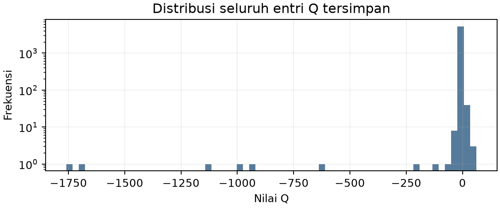
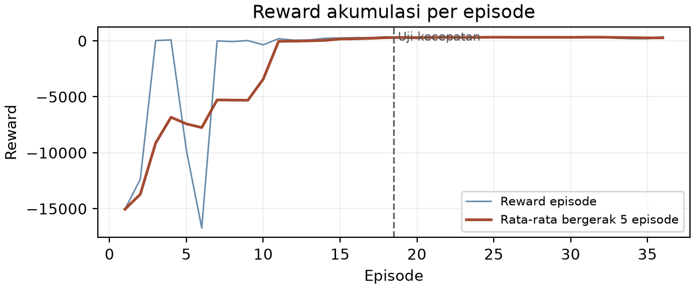
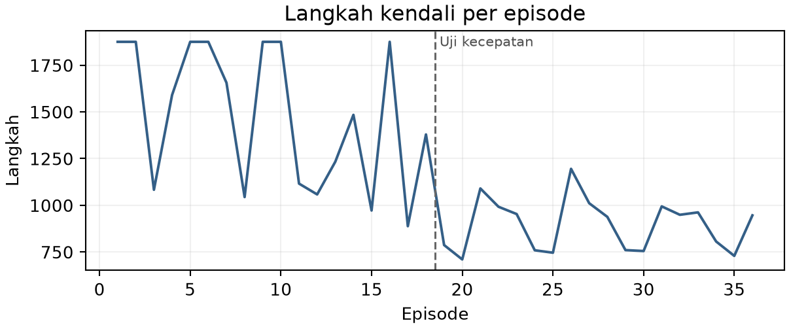
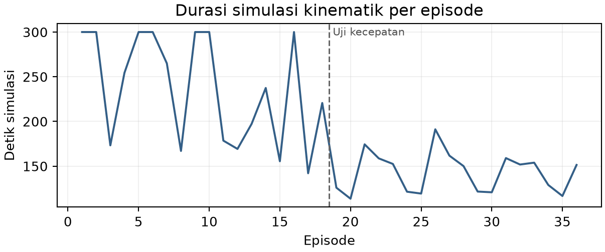
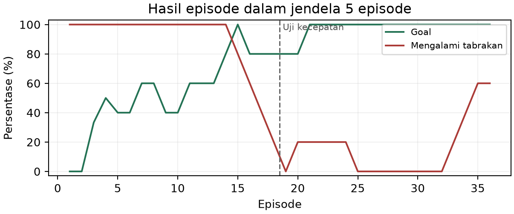
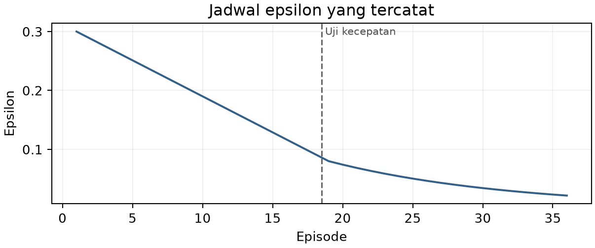
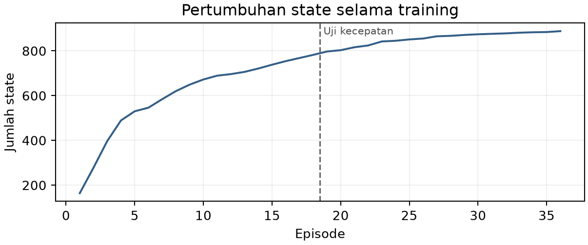
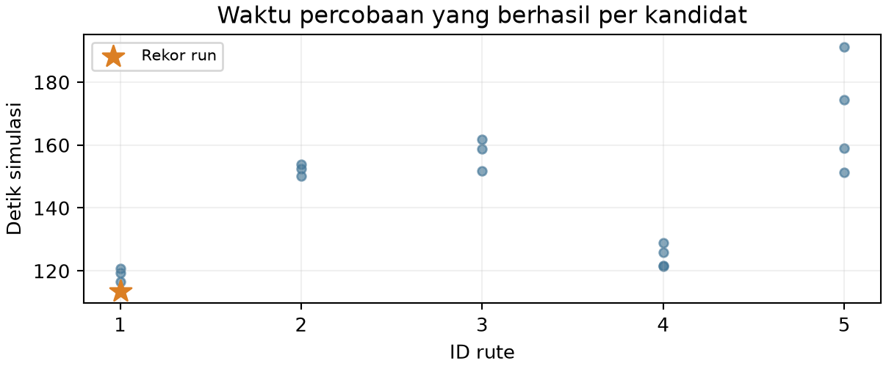
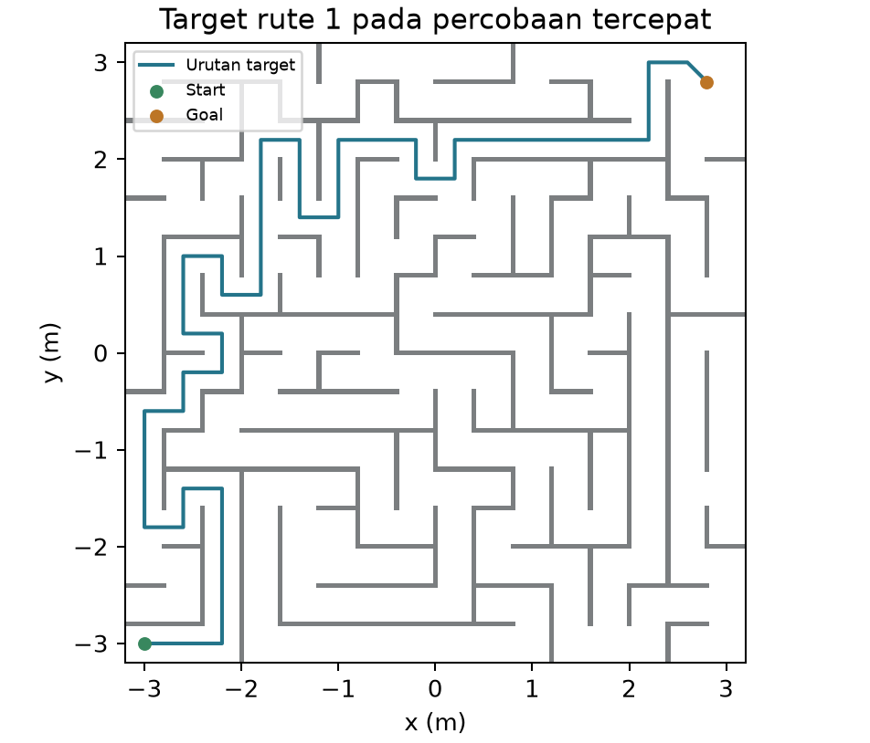
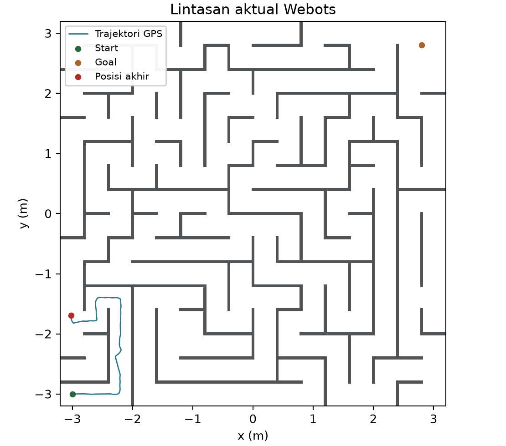

# Analisis Tabular Q-Learning pada Continuous Environment

## Ringkasan

Micromouse menjelajahi maze dengan memisahkan pencarian rute dari pengendalian roda. DFS menentukan target lokal dari pemindaian LiDAR depan. Tabular Q-learning memilih satu dari enam aksi untuk mendekati target tersebut. Posisi, arah hadap, dan respons aktuator berkembang secara kontinu.

Audit dan training ulang menggunakan commit 5c4cf33. Run menyelesaikan 36 dari 36 episode yang direncanakan. Dari 18 episode eksplorasi diperoleh 5 kandidat rute. Uji kecepatan dimulai pada episode 19. Rute 1 mencatat waktu terendah 113,60 detik simulasi pada episode 20.

Checkpoint memuat 888 state atau 11,42% dari batas teoretis. Evaluasi kinematik greedy mencatat 9/12 keberhasilan. Waktu terbaik berasal dari percobaan kinematik yang mencapai goal pada fase uji kecepatan. Bukti Webots dilaporkan terpisah.

### Fokus laporan

Laporan menilai implementasi, isi checkpoint, dan hasil observasi pada versi yang diaudit. Bukti utama adalah kode snapshot, arsip eksperimen, pengujian yang dijalankan, dan telemetry Webots pada lampiran data.

## 1 Pendahuluan

### 1.1 Latar belakang

Robot yang menjelajahi lorong sempit perlu mengetahui cabang yang masih bisa diperiksa serta menyesuaikan gerak di dekat dinding. Sensor jarak membantu mengamati jalur yang berada di depan robot. Peta koneksi antar sel dapat dibangun saat robot berjalan dengan mencatat bagian maze yang sudah terlihat.

### 1.2 Rumusan masalah

Bagaimana DFS menentukan target lokal dari LiDAR, bagaimana Q-learning memilih gerak menuju target tersebut, dan sejauh mana checkpoint yang tersedia dapat menyelesaikan perjalanan dari start ke goal?

### 1.3 Tujuan

Mengaudit alur kendali dan pembelajaran, mengekstrak nilai Q aktual, mengevaluasi hasil training serta pengujian, dan mendokumentasikan batas bukti untuk setiap klaim.

### 1.4 Ruang lingkup

Kajian mencakup satu arena, satu implementasi tabular, satu run training ulang dengan skema state versi 9 serta pengujian Webots pembanding yang disajikan terpisah. Pembahasan mutu kebijakan dibatasi oleh jumlah percobaan, konfigurasi sensor, dan data yang benar-benar tersedia.

## 2 Landasan Teori

### 2.1 Continuous environment dan differential drive

Dalam lingkungan kontinu, posisi x dan y serta heading dapat berada di antara pusat sel atau arah kardinal. Pada differential drive, perbedaan kecepatan roda kiri dan kanan menghasilkan rotasi. Kombinasi kecepatan maju dan laju putar dapat menghasilkan lintasan lengkung. Pusat sel berfungsi sebagai target lokal, dengan toleransi tertentu ketika dicapai.

### 2.2 Reinforcement learning dan Q-learning

Agen menerima reward dari interaksi dengan lingkungan. Q-learning memperbarui estimasi nilai tindakan dengan reward langsung dan estimasi terbaik pada state berikutnya [1–2]. Bentuk tabular menyimpan nilai per kombinasi state dan aksi. Perkembangan pose kontinu pada proyek ini dipadukan dengan representasi sensor dan aksi yang diskret.

### 2.3 LiDAR, DFS, dan target lokal

LiDAR mengukur jarak menurut arah sinar. Dalam proyek ini, minimum sudut dipakai untuk keputusan gerak, sedangkan titik pantul dipakai untuk memeriksa koridor. DFS menyelusuri cabang berdasarkan tumpukan sel. Saat buntu, DFS kembali ke sel sebelumnya untuk mengecek cabang lain.

### 2.4 Eksplorasi aksi dan fungsi reward

Epsilon-greedy memilih aksi acak dengan peluang epsilon dan aksi bernilai tinggi pada kesempatan lainnya. Reward mengarahkan perilaku melalui kemajuan, keselamatan, biaya waktu, serta bonus pencapaian. Pilihan cabang DFS dan eksplorasi aksi Q-learning bekerja pada dua tingkat keputusan yang berbeda.

## 3 Metodologi

### 3.1 Arena, sensor, dan konfigurasi

**Tabel 1. Spesifikasi snapshot acuan**

| Aspek | Konfigurasi |
| --- | --- |
| Arena | 6,40 × 6,40 m, kisi 16 × 16, ukuran sel 0,40 m |
| Start dan goal | Start (−3,00; −3,00) m, goal (2,80; 2,80) m |
| Sensor Webots | GPS, IMU, LiDAR depan 180° dan 128 sinar. Jangkauan 0,02–4,00 m pada PROTO. |
| Langkah waktu | Webots 16 ms, satu keputusan gerak tiap 160 ms. Model kinematik memakai sublangkah 16 ms. |
| Toleransi target | Waypoint 0,055 m, goal 0,09 m dari pusat target. |

Sumber worlds/world.wbt, protos/Micromouse.proto, lidar_q_env.py dan lidar_q_webots.py pada 5c4cf33.

### 3.2 Alur arsitektur

Pose dari GPS/IMU dan titik LiDAR masuk ke DFS → DFS menghasilkan target lokal → kode state dibentuk dari arah, jarak, dan lima sektor sensor → filter keselamatan dan Q-table menentukan gerak → roda mengubah pose → reward dan state berikutnya dikembalikan ke trainer.

### 3.3 Akuisisi sensor dan pemilihan cabang

Titik valid LiDAR ditransformasikan ke koordinat arena menggunakan pose robot. DFS memeriksa empat tetangga kardinal, memberi prioritas berdasarkan jarak ke goal dan gangguan acak terkontrol seed, serta menyimpan edge yang terdeteksi terbuka. Arah probe harus berada dalam ±55° dari heading. Bila cabang belum terlihat, robot melakukan putar atau berhenti sesuai mask. Bila cabang habis, DFS kembali melalui tumpukan dan akhirnya dapat menandai pencarian habis.

## 4 Representasi State dan Aksi

Kode state terdiri dari tujuh integer dengan urutan bearing, jarak, depan, depan-kiri, kiri, kanan, lalu depan-kanan. Setiap sektor menggunakan jarak minimum. Sektor yang tidak berisi titik valid bernilai maksimum 4 m dalam agregasi.

**Tabel 2. Batas kategori state**

| Fitur | Kategori dan arti |
| --- | --- |
| Bearing (8) | b=0…7 dengan interval [−180° + 45°b, −135° + 45°b). Sudut negatif berarti target di kanan dan positif berarti di kiri. |
| Jarak target (4) | 0 [0; 0,10), 1 [0,10; 0,25), 2 [0,25; 0,50), 3 [0,50; ∞) m. |
| Masing-masing sektor LiDAR (3) | 0 [0; 0,16) m dekat, 1 [0,16; 0,45) m sedang, 2 [0,45; 4,00] m jauh. |

Sumber discretize_state dan metadata q_table.json.

Batas kombinatorial adalah 8 × 4 × 3 pangkat 5 = 7.776 state. Tabel dibuat secara sparse ketika state diminta oleh kode. Batas ini mencakup kombinasi yang mungkin tidak muncul di arena.

**Tabel 3. Perintah dasar ke aktuator**

| ID | Aksi | Linear (m/s) | Angular (rad/s) |
| --- | --- | --- | --- |
| 0 | Maju | 0,23 | 0,00 |
| 1 | Lengkung kiri | 0,19 | +1,15 |
| 2 | Lengkung kanan | 0,19 | −1,15 |
| 3 | Putar kiri | 0,00 | +2,70 |
| 4 | Putar kanan | 0,00 | −2,70 |
| 5 | Berhenti | 0,00 | 0,00 |

Sumber ACTION_VW dan metadata q_table.json.

Target roda kiri dan kanan dihitung dengan (v ∓ ωL/2)/r. Jarak antarroda L = 0,104 m dan radius roda r = 0,027 m. Batas roda 17 rad/s, batas percepatan 45 rad/s², dan konstanta waktu respons 0,08 s membatasi perubahan gerak. Aksi berhenti memberi target nol dan roda melambat melalui respons aktuator.

## 5 Reward dan Pembaruan Nilai Q

**Tabel 4. Komponen reward setiap keputusan**

| Komponen | Rumus atau nilai | Peran |
| --- | --- | --- |
| Progress | 4(d lama − d baru), meter | Mendekati target lokal. |
| Heading | 0,20(|e lama| − |e baru|), rad | Mengurangi galat arah. |
| Waktu | −0,025 setiap keputusan | Mengurangi durasi. |
| Jarak | −0,50 × perpindahan, meter | Mengurangi gerak berlebih. |
| Dinding | −0,45 w × clip((0,24 − c)/0,24; 0; 1) | Menjaga jarak. c adalah jarak minimum sektor terkait aksi. w=1,5 saat maju, selain itu 1. |
| Waypoint | +4 pada pencapaian target antara | Mendukung progres DFS. |
| Goal | +120 pada target akhir | Menandai keberhasilan. |
| Tabrakan | −100 per kejadian baru | Menghukum kontak. |
| Stagnasi | −0,10 jika perpindahan <0,002 m dan perbaikan galat <0,05 rad | Mengurangi langkah tanpa progres. |

Sumber LidarQEnvironment.step pada 5c4cf33.

Pada scanning dan pemulihan kontak, komponen progress, heading, bonus target, dan stagnasi tidak aktif. Biaya waktu, biaya jarak, dan penalti dinding tetap dihitung. Kejadian kontak baru dapat muncul saat scanning. Kontak ketika pemulihan sedang aktif tidak kembali dikenai penalti kejadian baru. Monitoring menjumlahkan reward seluruh langkah termasuk gerak paksa.

Q(s,a) ← Q(s,a) + α[r + γ max Q(s′,a′) − Q(s,a)]. Maksimum memakai aksi yang diizinkan pada state berikutnya. Bila goal tercapai atau trainer menandai pergantian ke kondisi tanpa target lokal untuk pembaruan, target Bellman hanya r. Timeout membatasi episode tanpa mengubah target Bellman menjadi terminal pada kode acuan.

### Contoh hitung ilustratif bukan data eksperimen

Jika Q lama = 2, r = 1, maksimum Q yang diizinkan pada state berikutnya = 4, α = 0,16, dan γ = 0,98, targetnya 4,92. Pembaruan memberi 2 + 0,16 × (4,92 − 2) = 2,4672. Log arsip tidak menyimpan contoh transisi lengkap per langkah.

## 6 Implementasi Program

**Tabel 5. Pembagian modul dan fungsi**

| Modul | Fungsi utama |
| --- | --- |
| maze_search.py | LidarMazeSearch.next_target dan scan_action mengamati edge, memilih target, memindai dan melakukan backtracking. |
| lidar_qlearning.py | Agregasi sensor, discretize_state, safe_actions, WaypointRecovery, serta TabularLidarQ.values, choose, update, save dan load. |
| lidar_q_env.py | Reset, integrasi gerak, pengujian benturan, reward, timeout dan recovery. |
| train_lidar_q.py | run_episode, evaluate, jadwal epsilon, peralihan fase, dan penyimpanan log/checkpoint. |
| lidar_q_webots.py | GPS/IMU/LiDAR dari perangkat Webots, pemilihan aksi greedy, motor, dan telemetry. |

Sumber file sumber dalam snapshot 5c4cf33.

### 6.1 Penyaringan aksi dan eksplorasi

Aksi maju memerlukan sektor depan ≥0,16 m. Lengkung memerlukan sektor depan dan diagonal pada sisi belok ≥0,16 m. Putar memerlukan seluruh minimum sektor ≥0,087 m dari radius robot 0,075 m ditambah margin 0,012 m. Berhenti menjadi fallback. Mask dapat menyingkirkan aksi dengan Q tertinggi. WaypointRecovery dapat mempersempit aksi lagi berdasarkan bearing dan progres. Secara bawaan, pemilihan training mengundi aksi bernilai seri. Evaluasi memakai pilihan maksimum pertama pada urutan aksi yang diizinkan.

### 6.2 Episode, recovery, dan pergantian fase

Tabrakan pada model kinematik menolak posisi kandidat, menghentikan roda, dan memicu pemulihan mundur −0,09 m/s selama 0,8 detik dengan pemeriksaan geometri. Episode tetap berjalan. Scanning dan pemulihan kontak melewati update Q pada langkah gerak paksa. Visits bertambah ketika choose dipanggil, sedangkan state baru bisa tercatat dengan visits nol karena diminta oleh lookup atau update.

Training masuk speed_test pada batas antar episode ketika kuota minimum dan setidaknya satu rute sukses tersedia. Rute dibersihkan dari putaran kembali, diuji bergiliran dengan heading nol, dan rekor hanya diperbarui pada sukses. Explore mengubah epsilon dari 0,30 menuju 0,08. Fase uji bergerak dari sekitar 0,08 menuju batas bawah 0,02 sesuai jadwal.

## 7 Konfigurasi dan Q-table Aktual

**Tabel 6. Konfigurasi run yang dianalisis**

| Parameter | Nilai |
| --- | --- |
| Run | 20261121T125626.506320742Z |
| Training | Seed 42, α=0,16, γ=0,98, 300 s per episode, 0,16 s per keputusan. |
| Rencana dan capaian | 36 episode direncanakan, 36 tercatat, 42,710 langkah. Kuota eksplorasi 18 episode (50%). |
| Jadwal aktual | Eksplorasi episode 1–18, uji kecepatan episode 19–36. Epsilon 0,300000 hingga 0,021601. |

Sumber run.json, training.csv dan q_table.json.

**Tabel 7. Sepuluh state dengan visits tertinggi**

| Kode state | Maju | L. kiri | L. kanan | P. kiri | P. kanan | Stop | Visits |
| --- | --- | --- | --- | --- | --- | --- | --- |
| 4,2,1,1,1,1,1 | 1,025 | 4,016 | 2,636 | 2,526 | 2,188 | 0,000 | 2050 |
| 3,2,1,1,1,1,1 | 2,245 | 3,263 | 3,739 | 2,897 | 3,239 | 0,000 | 1858 |
| 3,1,1,1,1,1,1 | 4,213 | 4,411 | 5,735 | 4,046 | 4,344 | 0,000 | 1722 |
| 4,1,1,1,1,1,1 | 4,177 | 5,857 | 3,142 | 4,494 | 3,759 | 0,000 | 1524 |
| 3,2,2,1,1,1,1 | 0,201 | 0,055 | 4,023 | 2,142 | 1,882 | 0,000 | 920 |
| 3,1,1,1,1,2,1 | 5,715 | 4,347 | 3,798 | 3,331 | 4,252 | 0,000 | 917 |
| 4,2,2,1,1,1,1 | 0,922 | 4,133 | 1,370 | 2,920 | 1,120 | 0,000 | 905 |
| 4,2,1,1,1,0,0 | -48,837 | 3,629 | 0,000 | -0,881 | -3,684 | 0,000 | 885 |
| 3,2,1,0,0,1,1 | 2,933 | 0,000 | 1,788 | 1,792 | 2,243 | 0,000 | 824 |
| 4,1,1,1,2,1,1 | 2,166 | 6,144 | 3,477 | 3,241 | 3,083 | 0,000 | 669 |

Sumber q_table.json, dibulatkan 3 desimal. Presisi sumber tersedia pada CSV.

### 7.1 Isi file checkpoint

Sebanyak 888 state tersimpan atau 11,42% dari batas teoretis. Kolom Stop menyatakan aksi Berhenti. Ringkasan mencatat 910 setelah evaluasi. Evaluator dapat menambahkan baris nol di memori, karena checkpoint disimpan sebelum evaluasi.

## 8 Dekode State dan Distribusi Nilai Q

### 8.1 Interpretasi tiga state aktual

Tiga kode berikut berasal dari baris teratas Q-table aktual. Urutan lima sektor adalah depan, depan-kiri, kiri, kanan, depan-kanan. Pilihan greedy bersyarat dihitung dari nilai Q dan rentang sensor yang konsisten dengan state. Epsilon dan recovery dapat mengubah keputusan pada langkah tertentu.

**Tabel 8. Dekode tiga state teratas**

| Kode state | Bearing, jarak target dan lima sektor | Pilihan greedy yang mungkin |
| --- | --- | --- |
| 4,2,1,1,1,1,1 | [0°; 45°), [0,25; 0,50) m. LiDAR sedang, sedang, sedang, sedang, sedang | Lengkung kiri |
| 3,2,1,1,1,1,1 | [-45°; 0°), [0,25; 0,50) m. LiDAR sedang, sedang, sedang, sedang, sedang | Lengkung kanan |
| 3,1,1,1,1,1,1 | [-45°; 0°), [0,10; 0,25) m. LiDAR sedang, sedang, sedang, sedang, sedang | Lengkung kanan |

Sumber q_table.json dan batas discretize_state. Keenam nilai Q ada pada tabel sebelumnya.

### 8.2 Distribusi dan keterbatasan inferensi

Sebanyak 1 state memiliki visits nol, 461 state memiliki 1–5 visits, dan 69 state memiliki setidaknya 100 visits. Rata-rata visits 42,53 dan median 5.0. Nilai Q terendah -1759,430 dan tertinggi 61,831. Dari 5,328 entri, 861 negatif, 1,025 positif, dan 3,442 nol.

Distribusi aksi aktual tidak dapat direkonstruksi dari visits per state. Rentang LiDAR kategori 0 juga melintasi ambang putar 0,087 m. Karena itu hasil argmax dari jarak representatif hanya cocok sebagai simulasi mask, bukan sebagai distribusi aksi aktual. Adanya tabel, nilai ekstrem, atau bertambahnya jumlah state belum menunjukkan konvergensi.

Sumber data/q_table.json.

## 9 Hasil Eksperimen Kinematik

**Tabel 9. Ringkasan training dan evaluasi**

| Metrik | Training ulang | Evaluasi greedy |
| --- | --- | --- |
| Mencapai goal | 29/36 (80,56%) | 9/12 (75,00%) |
| Gagal mencapai goal | 7 | 3 |
| Episode dengan tabrakan | 18 | 6 |
| Total kejadian tabrakan | 564 | 16 |
| Sukses yang juga menabrak | 12 | 3 |
| Timeout | 7 | 3 |
| Pencarian habis | 0 | 0 |
| Waktu tempuh sukses | Rekor uji 113,60 s | Median 135,68 s |

Sumber training.csv, evaluations.json dan summary.json. Timeout diturunkan dari batas 1.875 langkah serta status kegagalan.

Evaluasi menjalankan kebijakan greedy tanpa update Q. 12 seed pencarian dipasangkan dengan delapan heading yang berulang. Angkanya menggambarkan percobaan pada arena yang sama.

Episode sukses dan episode dengan tabrakan dapat tumpang tindih. Sebanyak 12 dari 29 episode sukses mengalami kontak sebelum mencapai goal.

### 9.1 Evaluasi kegagalan

Kegagalan mencakup timeout atau pencarian habis menurut indikator pada tabel. Penalti kontak berulang dapat menjatuhkan reward jauh di bawah nol meskipun robot sempat mencapai banyak waypoint. Log episode tidak cukup untuk menemukan lokasi tembok atau urutan aksi yang menyebabkan setiap kejadian. Agregasi LiDAR minimum, state diskret, dan informasi parsial ke target adalah keterbatasan representasi yang perlu diuji lebih lanjut.

### 9.2 Waktu proses dan waktu simulasi

Durasi pada grafik adalah steps × 0,16 s. Angka training_seconds pada ringkasan versi ini dihitung setelah evaluasi dan dapat memuat waktu tampilan. Angka tersebut tidak dipakai sebagai waktu proses training murni.

## 10 Grafik Reward dan Langkah

Sumber data/training.csv.

Sumber data/training.csv.

Reward rata-rata -1309,40, dengan rentang -16722,74 sampai 365,08. Puncak 1.875 langkah berarti seluruh jatah 300 detik simulasi terpakai. Garis putus-putus menandai uji kecepatan.

## 11 Grafik Durasi dan Hasil Episode

Sumber data/training.csv.

Sumber data/training.csv.

Awal kurva menggunakan episode yang tersedia sampai jendela mencapai lima. Kedua garis dapat bernilai tinggi sekaligus karena tabrakan dan goal dapat terjadi dalam satu episode.

## 12 Grafik Epsilon dan Pertumbuhan Q-table

Sumber data/training.csv.

Sumber data/training.csv.

Garis putus-putus diletakkan di antara episode 18 dan 19 berdasarkan fase pada training.csv. Grafik memperlihatkan perubahan epsilon pada episode aktual, bukan jadwal yang diproyeksikan.

## 13 Hasil Uji Kecepatan

Eksplorasi berlangsung selama 18 episode dan menghasilkan 5 kandidat. Pada uji kecepatan, kandidat diputar bergiliran dari heading awal nol. Tercatat 18 percobaan, dengan 18 mencapai goal. Rute 1 paling cepat dalam run ini, yaitu 113,60 detik simulasi pada episode 20 (710 langkah dan 1 kejadian tabrakan).

Percobaan tercepat tanpa tabrakan adalah rute 1 pada episode 25 dengan 119,36 detik simulasi. Waktu ini berguna jika keselamatan menjadi kriteria tambahan.

**Tabel 10. Kandidat rute dan hasil uji kecepatan**

| Rute | Percobaan | Sukses | Waktu terbaik (s) | Eksplorasi (s) | Status |
| --- | --- | --- | --- | --- | --- |
| 1 | 4 | 4 | 113,60 | 155,52 | Sukses |
| 2 | 3 | 3 | 150,08 | 254,40 | Sukses |
| 3 | 3 | 3 | 151,84 | 237,44 | Sukses |
| 4 | 4 | 4 | 121,44 | 142,08 | Sukses |
| 5 | 4 | 4 | 151,36 | 220,64 | Sukses |

Sumber data/routes.json.

Sumber data/training.csv dan routes.json.

Waktu eksplorasi dapat mencakup pemindaian dan kembali dari cabang buntu. Waktu uji berasal dari replay urutan target tanpa loop yang ditemukan DFS. Kebijakan masih diperbarui dan epsilon masih aktif selama training, sehingga rekor dapat berubah pada pengujian lain. Optimum global belum diuji.

## 13.1 Target Rute dengan Waktu Terendah

Sumber data/routes.json dan geometri world pada commit acuan.

Garis menunjukkan urutan target yang diberikan ke pengendali saat uji kecepatan. Lintasan robot di antara target berkembang secara kontinu. Log training menyimpan hasil episode serta urutan target, sehingga garis ini tidak ditafsirkan sebagai telemetry pose per langkah.

## 14 Validasi Webots Terpisah

Uji Webots menggunakan checkpoint yang sama dari run 20261121T125626.506320742Z, seed pencarian 6, dan mode exploration. Percobaan penuh melewati batas 90 detik waktu proses tanpa menyimpan hasil akhir. Pengujian singkat berikut menggunakan batas 24 detik simulasi. Webots menggunakan perangkat GPS, IMU, dan point cloud LiDAR. Training memakai pengamatan sintetis dan integrasi model. Kontak dalam log Webots ditentukan dengan clearance geometris.

**Tabel 11. Hasil uji singkat Webots dengan checkpoint baru**

| Metrik | Hasil |
| --- | --- |
| Status dan durasi | Timeout, 24,000 s simulasi |
| Jarak lintasan dan galat goal | 3,707 m dan 7,35036 m |
| Tabrakan dan timeout | 0 kejadian tercatat. Timeout ya. |
| Clearance minimum | 0,01498 m menurut perhitungan geometri |

Sumber data/webots_latest_run.json, satu percobaan dengan snapshot 5c4cf33.

Sumber data/webots_latest_run.json.

Uji Webots mengikuti eksplorasi online. Durasi dan jalurnya tidak dipakai untuk menentukan rekor uji kecepatan kinematik. Uji singkat memeriksa gerakan dan pengamatan sensor. Penyelesaian start sampai goal oleh checkpoint baru di Webots belum terverifikasi.

## 15 Kesimpulan dan Daftar Pustaka

Implementasi acuan membagi pencarian target pada DFS dan pemilihan enam aksi pada tabular Q-learning. Training ulang menyelesaikan 36 episode, menemukan 5 kandidat, dan mencatat rekor 113,60 detik pada rute 1. Persentase sukses evaluasi greedy adalah 75,00%. Rekor terbatas pada kandidat dan kondisi uji yang dijalankan, dan tabrakan serta timeout tetap perlu diperhatikan.

### Daftar Pustaka

[1] Watkins, C. J. C. H., dan Dayan, P. (1992). Q-learning. Machine Learning, 8, 279–292. https://doi.org/10.1023/A:1022676722315

[2] Sutton, R. S., dan Barto, A. G. (2018). Reinforcement Learning: An Introduction (edisi kedua). MIT Press. https://mitpress.mit.edu/9780262039246/reinforcement-learning/

[3] FechL. RL-pathfinding, snapshot 5c4cf33c2e045245be1cf49340a5a5e7eb27f5fa. https://github.com/FechL/RL-pathfinding/tree/5c4cf33

## Lampiran Sumber Data dan Reproduksibilitas

Snapshot acuan 5c4cf33 diekstrak dengan git archive. Training ulang memakai seed 42, 36 episode, kuota eksplorasi 50%, batas 300 detik, 12 evaluasi, serta tanpa rendering. Jatah sengaja dipangkas agar kedua fase terukur pada run yang sama. Definisi state, aksi, reward, dan algoritma mengikuti snapshot acuan. Artefak asli tetap tersedia di reports/lidar_q_learning/runs/20261121T125626.506320742Z/.

**Tabel 12. Pemetaan artefak hasil**

| Artefak | Isi |
| --- | --- |
| data/run.json dan training.csv | Konfigurasi dan log 36 episode. |
| data/q_table.json dan q_table_export.csv | Checkpoint asli dan seluruh 888 baris nilai Q serta visits. |
| data/q_table_sample.csv | Sepuluh state dengan visits tertinggi tanpa pembulatan. |
| data/routes.json dan evaluations.json | Kandidat, rekor uji kecepatan, dan 12 evaluasi greedy. |
| data/webots_latest_run.json | Telemetry Webots dari checkpoint baru, dalam uji eksplorasi terpisah. |
| analysis/qlearning_validation.md | Hasil tes dan temuan batasan implementasi. |

Sumber inventaris output/q_learning.

### Jejak sumber

- `q_table.json` · SHA-256 `9d14cc068d44a19a57eb87b06c85abd4f2a379d58c0372d6bb2d5bd1cbfd5197`
- `training.csv` · SHA-256 `e47de89709a16fcf0b4a47ab9f4ec032ea179331c77cd034b46f387e4c1e35d1`
- `routes.json` · SHA-256 `488e5f3b88254bd189bab83b0f32df378867e1fcc6fb1c18c78ac9011224b406`
- `run.json` · SHA-256 `7e2dc6cb90874ec59f0a69e6bbe11d56da7a40fa88bba4241c4bc41f2d410b4f`
- `summary.json` · SHA-256 `84726b2e00e870d8891f1df72e1b7e5885cdbabc9c2a10d27ece836cd59e3424`
- `evaluations.json` · SHA-256 `f9f3e01b6362f3815d2b7c2222ee35b58b5c1001e68b1015d7967ab7b8681984`
